# Swedish EL Data Platform: System Architecture

[[_TOC_]]

## 1. System Architecture Flow

The following diagram illustrates the end-to-end data flow.

```mermaid
graph TD
classDef storage fill:#0072C6,stroke:#fff,stroke-width:2px,color:#fff;
classDef compute fill:#FF3621,stroke:#fff,stroke-width:2px,color:#fff;
classDef product fill:#107C10,stroke:#fff,stroke-width:2px,color:#fff;

A[External APIs / CSVs<br/>ENTSO-E · SMHI · ECB · EIA · SCB] -->|Python REST ingest/ · nightly 20:00| B
B[(PostgreSQL 16: raw.*<br/>Verbatim JSON/XML/CSV)]:::storage -->|dbt: parsed, as-received, per-file replace| C
C[bronze.*]:::compute -->|dbt: typed, cleaned, EUR→SEK, UTC/Local ts| D
D[silver.*]:::compute -->|dbt: dims, fact_daily, drivers, gas| E
E[(gold.*)]:::storage --> F
E --> G
E --> H
F[sklearn price forecast<br/>price_forecast*]:::product
G[Static site · GitHub Pages<br/>ECharts price tracker]:::product
H[Metabase Analytics]:::product
```



* **Ingestion:** Python modules in `ingest/` execute parameterized `GET`/`POST` requests against 7 sources through a shared `common.py` helper, run nightly by `run_daily.sh` (launchd, 20:00 Europe/Stockholm), with a dedicated historical backfill mode.

* **Storage:** PostgreSQL 16 (`swedish_el`) is the landing zone and warehouse (schemas `raw` / `bronze` / `silver` / `gold`). Writes are idempotent on `(input_file_name, file_modification_time)`.

* **Data Processing:** dbt-core + dbt-postgres runs the Medallion stages (Raw → Bronze → Silver → Gold) every night, feeding a scikit-learn price forecast and a static ECharts site. Metabase (Docker) serves internal analytics.

---

## 2. Data Sources & Ingestion Cadence

All sources are pulled nightly at 20:00 Europe/Stockholm by launchd (`run_daily.sh`). The
`load_tier` column marks `historical` backfill vs `daily` incremental.

| **Data Source** | **Landing (raw table)** | **Frequency & Time** | **Ingestion Method** | **Target Metrics** |
| :--- | :--- | :--- | :--- | :--- |
| **ENTSO-E** | `raw_entsoe` | Daily, 20:00 | Python `GET` (XML/JSON) | Wholesale day-ahead spot prices (SE1–SE4), load, generation |
| **SMHI MetObs** | `raw_smhi_metobs` (+ archive rows) | Daily, 20:00 | Python `GET` (JSON/CSV) | Weather actuals (temperature, wind, precipitation) |
| **SMHI Forecast** | `raw_smhi_forecast` | Daily, 20:00 | Python `GET` (JSON) | Weather predictions (temperature, wind, ~10-day) |
| **SMHI Hydro** | `raw_smhi_hydro` | Daily, 20:00 | Python `GET` (JSON) | Water discharge (m³/s) across SE1–SE4 river basins |
| **ECB** | `raw_ecb` | Daily, 20:00 | Python `GET` (SDMX-JSON) | EUR→SEK exchange rates |
| **U.S. EIA** | `raw_eia` | Daily, 20:00 | Python `GET` (JSON) | Henry Hub natural gas spot prices (USD/MMBtu) |
| **SCB** | `raw_scb` | Daily (source updates monthly), 20:00 | Python `POST` (JSON) | Consumer contracts & household electricity prices, energy tax, grid fees |

> [!NOTE]
> Pre-2022 history is loaded through a dedicated backfill (`load_tier = 'historical'`); the nightly
> run is incremental (`load_tier = 'daily'`). Re-ingesting a source file replaces it, so job overlap
> never creates duplicates.

---

## 3. Strict Medallion Architecture (dbt + PostgreSQL)

The pipeline enforces strict design rules: idempotent writes at every layer, raw payloads are never mutated, and dbt tests gate the run.

> Column-level documentation for every layer lives in its own folder: [`raw/README.md`](raw/README.md), [`dbt/models/bronze/README.md`](dbt/models/bronze/README.md), [`dbt/models/silver/README.md`](dbt/models/silver/README.md), [`dbt/models/gold/README.md`](dbt/models/gold/README.md), [`ml/README.md`](ml/README.md).

### Raw Layer (`raw.*`) — Verbatim Capture

* **Goal:** Idempotent capture of API responses exactly as received.
* **Process:** `ingest/` writes one row per file version, keeping the response body as `payload` (jsonb). `INSERT … ON CONFLICT (input_file_name, file_modification_time) DO UPDATE` ensures re-runs never duplicate.
* **Tables:** `raw_entsoe`, `raw_ecb`, `raw_eia`, `raw_scb`, `raw_smhi_forecast`, `raw_smhi_metobs`, `raw_smhi_hydro`, plus `smhi_metobs_archive_rows` (parsed CSV archive).

### Bronze Layer (`bronze.*`) — Parsed, As-Received

* **Goal:** Flatten payloads while keeping values as original strings.
* **Process:** dbt incremental model. Parses only new or changed files (based on `file_modification_time`) and replaces that file's rows — a per-file replace.
* **Tables:** `entsoe_points`, `scb_price_measures`, `ecb_fx_rates`, `eia_gas_prices`, `smhi_forecast_points`, `smhi_hydro_observations`, `smhi_metobs_observations`.

### Silver Layer (`silver.*`) — Typed & Cleaned

* **Goal:** Analysis-ready time-series.
* **Transformations:** Full-refresh dbt models. Type columns, cast `ts_utc`/`ts_local` (Europe/Stockholm), deduplicate (newest `file_modification_time`; archive over daily snapshots), convert units and currency. History window is strictly **2022-01-01 → today**.
* **Key conversions:** `price_sek_kwh = value (EUR/MWh) / 1000 × eur_sek_rate`; consumer prices `*_sek_kwh = *_ore_kwh / 100`; gas `÷ 293.071` (MMBtu→kWh).
* **Tables:** `entsoe_timeseries`, `fx_rates_daily`, `gas_prices_daily`, `consumer_prices`, `weather_forecast_hourly`, `weather_observations_hourly`, `smhi_hydro_observations_daily`.

### Gold Layer (`gold.*`) — Product Data Model

* **Goal:** Star schema for BI plus a flat product table.
* **Dims:** `dim_calendar` (daily spine 2022–2030, `date_key`), `dim_bidding_zone` (SE1–SE4, `zone_key`), `dim_station` (SMHI stations).
* **Facts:** `fact_daily` (zone × day grain). Joins prices, taxes, grid fees, weather and hydro.
  **Total consumer cost = `(price_sek_kwh_avg + energy_tax_sek_kwh + grid_fee_sek_kwh) × 1.25`** (25% VAT).
* **Also:** `gas_price_daily_sek`, `driver_daily` (un-pivoted drivers), and the product table.
* **Product:** `thermostat_dataset_stockholm` — flat, self-contained SE3/SE4 dataset for the smart-thermostat / heating use case.

---

## 4. Execution, CI/CD, & Orchestration

* **Scheduler:** macOS launchd (`com.mlinggar.swedish-el`) runs `run_daily.sh` nightly at 20:00 Europe/Stockholm, wrapped in `caffeinate` so the Mac stays awake.
* **Pipeline chain:** `run_daily.sh` runs 7 Python ingest modules → `dbt build` (bronze/silver/gold + tests) → `jupyter nbconvert` for the ML forecast → `build_site.py` → auto-commit & push `docs/` to GitHub Pages.
* **ML:** `ml/price_forecast.ipynb` (scikit-learn GradientBoosting + quantile bands) writes `gold.price_forecast*`.
* **BI:** Metabase OSS (Docker) for internal dashboards (spot volatility, true consumer bill, zone spreads); dashboards are defined as code in `metabase/`.
* **Deployment:** code is edited locally and pushed to GitHub; the nightly run refreshes the site data and pushes the generated `docs/`.

```bash
# Nightly pipeline (launchd runs this at 20:00)
./run_daily.sh

# Or run the stages by hand:
python -m ingest.entsoe && python -m ingest.scb   # … (7 sources)
dbt build --project-dir dbt --profiles-dir dbt
jupyter nbconvert --to notebook --execute ml/price_forecast.ipynb
python site/build_site.py
```

---

## 5. Infrastructure Cost Optimization

The platform runs entirely on one Mac with free, open-source software. Total software cost is
**~$0 / year**.

| Service | Compute Model | Estimated Cost | Notes |
| :--- | :--- | :--- | :--- |
| **PostgreSQL 16** | self-hosted (existing Mac) | **$0 / year** | Single node; schemas raw/bronze/silver/gold. |
| **dbt-core + dbt-postgres** | open source | **$0 / year** | Medallion transforms + tests. |
| **scikit-learn** | open source | **$0 / year** | GradientBoosting price & bill forecast. |
| **GitHub Pages** | free (public repo) | **$0 / year** | Static ECharts site. |
| **Metabase OSS** | Docker on the Mac | **$0 / year** | Internal BI dashboards. |

> [!TIP]
> There is nothing to migrate to cut cost — it is already free. The only ongoing expense is the
> electricity to keep the Mac awake at 20:00, and the site's "plan your use" section tells you
> exactly when that is cheapest.

---

## 6. End-Use Applications

1. **Public electricity price tracker (GitHub Pages):** live spot + all-in bill, day/week/month forecast with a p10–p90 band, bill breakdown, "plan your use" (cheapest hours), zone comparison (SE1–SE4), "what moves the price" (drivers + correlation), postcode→zone finder and a monthly bill estimator.
2. **ML price & bill forecast:** scikit-learn GradientBoosting produces `price_forecast` (spot p50 + p10–p90) and the all-in bill `(spot + tax + fee) × 1.25` for the next day, week and month.
3. **Metabase analytics:** internal dashboards for hourly price volatility, true consumer bill estimation and zone comparisons (SE1 vs SE4 spreads).
4. **Smart-thermostat / heating product:** `thermostat_dataset_stockholm` (SE3/SE4) plus the "Warm your home for less" load-shifting demo — heat during the cheap overnight window and coast through the peaks.
